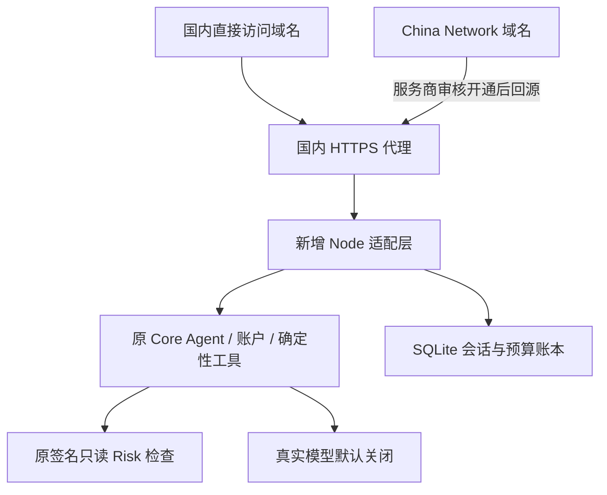

# 比赛部署并行模块 v1

交付日期：2026-10-29。目标：在保留已有 Cloudflare 站点的同时，准备 **China Network 接入**和**国内服务器部署**。本目录是新增模块，不迁移、不覆盖原路径，不包含 Vercel 方案。

## 先看当前结果

| 路线 | 本轮交付 | 尚未完成 |
| --- | --- | --- |
| 国内服务器 | 独立 Node 服务、SQLite 持久化、HTTPS 反向代理配置、容器配置、部署打包与验收脚本 | 服务器、域名、备案、云端发布和国内网络验收 |
| Cloudflare China Network | 供应商询价材料、兼容性核对表、域名与回源方案 | Enterprise 合同、China Network 开通、备案、内容审核、DNS 接入和实际验收 |

目前没有国内公网地址；不能把本地测试称为国内已经上线。现有 workers.dev 地址继续保留，国内可达性已收到失败反馈，不能单独用作比赛的国内入口。

## 两条路线如何并行



国内服务器路线负责网页和 API 都能独立运行，不再让浏览器访问 workers.dev。China Network 路线准备另一个加速入口，开通后可以指向同一国内后端。两条路线分别验收，一条上线不代表另一条也已上线。

新增适配层直接导入原业务模块，不重新计算金融规则、不修改 Memory 规则或公共 Contract。它用本地 SQLite 实现原业务实际使用的 get/put/transaction 存储接口，并跟踪原后台任务，支持 SSE。服务端存储失败就报错，不退回内存假装保存成功。

此版只适合**单机、单进程、一个持久卷**的比赛部署。没有实现跨云统一身份、跨浏览器登录和自动数据同步。同一国内后端的两个域名共享预算，但浏览器 Cookie 分开；原 Cloudflare 站点的数据和账本不会自动迁入。

## 第一步：资源准备（购买前核对）

国内路线需要：一个允许部署 Node/Docker 的 Linux 服务器、有效域名、HTTPS 和服务商要求的备案/接入条件。已有团队或学校的已备案域名和服务器最适合快速接入，但须由资源所有者授权并确认可用于本项目。

**不能承诺买服务器后立刻能公开使用大陆临时地址；用 IP 或临时域名并不能自动免除接入方的备案要求。** 在服务商审核通过前，本模块只能做本地验证。购买前确认：费用、带宽流量、有效期、备案所需购买时长，以及金融模拟演示内容是否符合接入要求。不要为了演示接真实支付或真实交易。

本机检测到 Docker 客户端，但 Docker 引擎未运行，因此本轮没有容器构建成功记录；Node 服务和 SQLite 已在本机实际运行测试。

## 第二步：国内服务器部署

在仓库根目录执行，或使用 scripts/package.mjs 生成的独立交付包：

```sh
cd chenchen/deployment/submission-parallel-v1
node build.mjs
node scripts/init-env.mjs --origin https://app.YOUR-DOMAIN.cn --mode disabled
```

脚本仅创建私有 `.env`，自动生成三个不同的随机密钥，不打印密钥、不覆盖现有 `.env`。替换为你真正持有并获准接入的域名。默认模型关闭；只需要明确的固定回复演示时可选择 `--mode demo`。demo 不调用真实模型，不代表模型效果验收。

Linux 服务器安装 Docker 和 Compose 后，在本目录执行：

```sh
docker compose --env-file .env -f domestic/compose.yaml config --quiet
docker compose --env-file .env -f domestic/compose.yaml build
docker compose --env-file .env -f domestic/compose.yaml up -d
docker compose --env-file .env -f domestic/compose.yaml ps
```

安全组开放 80/443，SSH 限制为管理员地址；4188 仅绑定服务器回环地址。Caddy 自动申请 HTTPS 证书，需要域名解析、80/443 和证书签发网络可用。容器镜像拉取也需要服务器能够访问镜像源；如果失败，改用服务商支持的镜像仓库，不改变代码。

`PUBLIC_HOSTS` 是 Caddy 的域名列表，多个域名用空格分隔；`ADDITIONAL_PUBLIC_ORIGINS` 是应用允许的额外 HTTPS 来源，多个来源用逗号分隔。没有实际开通 China Network 前不需要添加加速域名。

`.env` 和 SQLite 卷是私有材料，不能提交 GitHub。服务器从旧版本更新时继续使用同一个 `.env`、同一个数据库和同一个持久卷，不用重建账本来提高额度。

## 模型、Risk 和数据的真实边界

- `disabled`：不调用模型，账户、表格核对和历史可用；对话明确显示服务未开通。
- `demo`：固定测试回复，页面和回执标明 TEST_DOUBLE_NOT_LIVE；不用于证明真实模型能力。
- `external`：继续走原 createModelGateway、费用预留、结算和供应商协议；需另行批准真实调用和部署，配置价格/协议验证字段与服务端 Secret，不能借迁移提高生产预算。主备失败不会自动改成 demo 成功。
- 默认 Risk 使用原 `amount-readonly.1` 的签名只读分支；它不等于团队完整 Risk 网关的联合验收，也不新增资金权限。没有资金执行接口。
- 接入远程 Risk 时用 `RISK_TRANSPORT=https` 和真实 `RISK_SERVICE_URL`；双方配置同一 HMAC Secret，返回必须满足原 amount-risk.v1 绑定与签名。不能直接把一个风控网页链接填成 API。
- 原始数据、已确认快照与模拟方案仍分开保存；原人工确认与过期方案检查保留。并未声称迁移后具有新身份系统或跨平台自动授权。
- 新服务日志只记录随机请求编号、脱敏路由、状态和耗时，不输出 Cookie、密钥、问题正文或账户金额。

## 第三步：验收和比赛提交

```sh
node scripts/smoke.mjs https://app.YOUR-DOMAIN.cn local-mainland-smoke.json
```

此脚本只用合成账户、不调用模型，检查首页、健康状态、会话、账户汇总、重复提交、CSRF 拒绝和场景路由。**场景路由只说明“应该先检查什么”，不是已完成资金缺口计算、正式风控或交易。**

脚本成功不能自动证明国内可达。须在关闭代理的移动、电信、联通网络分别运行，并在 `evidence/ACCEPTANCE.md` 记录网络、时间和结果；真实模型/SSE、审批/模拟、Risk 拒绝和审核记录需另外实际操作验收。服务或真实模型不可用时展示失败。

## 打包与回滚

```sh
node scripts/package.mjs
```

输出到本模块 dist/，保留必要运行源码、容器配置、来源哈希和 Git 提交号，不带密钥、数据库、日志和私有 Git 历史。

回滚方式：保留上一个服务镜像和 `.env`，先停止流量/等待任务结束；用旧镜像重新启动，挂载同一个数据库卷。此版没有引入业务数据迁移。先用 SQLite 在线 backup 或停机后备份数据库；不要在运行中只复制主 sqlite 文件而丢失 WAL，不要用 `docker compose down -v` 删除卷。原 Cloudflare 服务未改动，可继续作为独立备用站，但它在大陆不可达的问题仍须如实说明。

China Network 材料见 [供应商对接清单](china-network/SALES-HANDOFF.md)、[回源与切换](china-network/ROUTING.md)。测试与未验收项见 [验收记录](evidence/ACCEPTANCE.md)。
