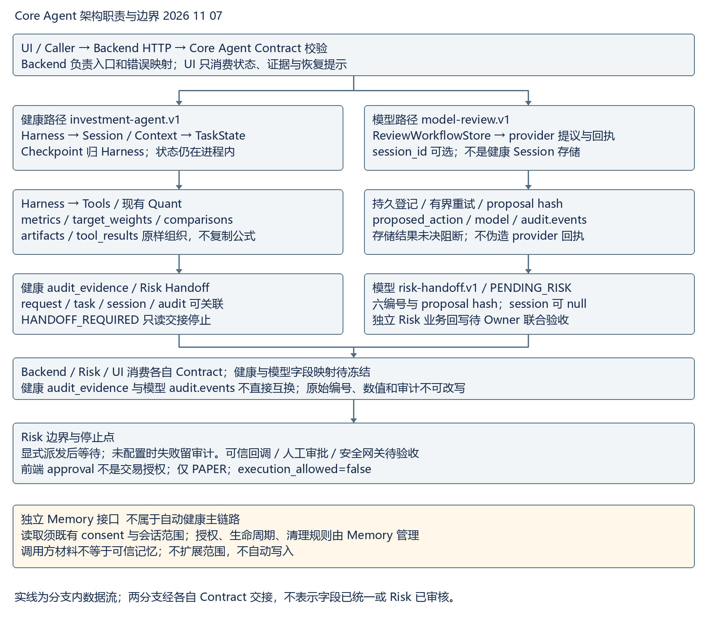
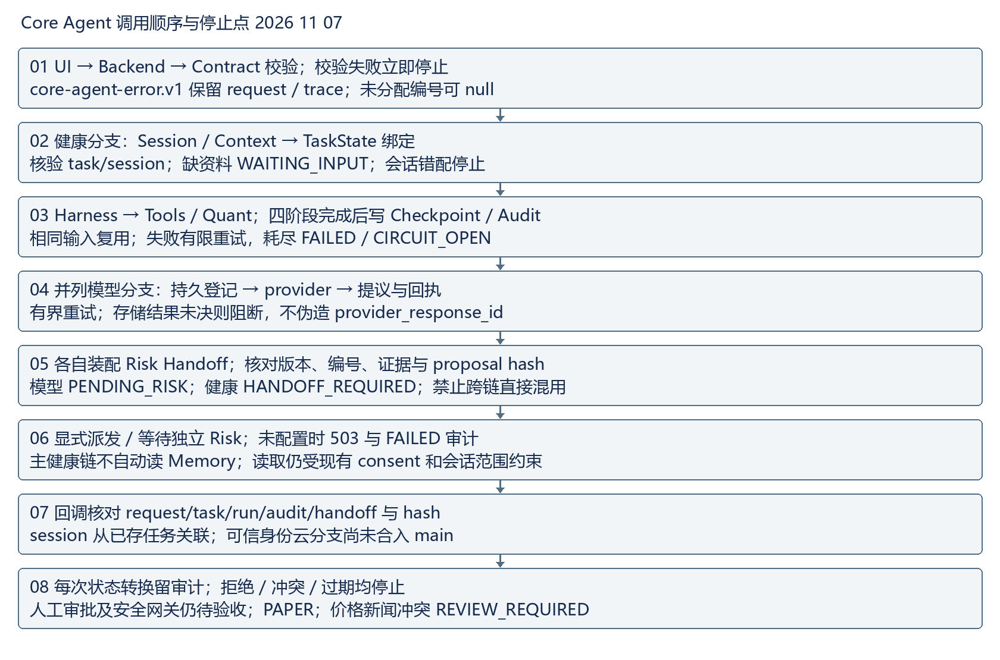

# Core Agent Daily Update 2026 11 09

## 今日结论与主链路阶段

今日无业务代码变更。两份 origin/main 在本轮检查前均无 2026-11-09 提交；团队远程基线 1480aca14a2f7844cfd2bdade94948936534acc7，个人远程基线 3cfa0091e3f60561b3ecc905c99d45fe46c49428。原始开发分支和未提交工作完整保留，本轮只在干净 main 快照更新 chenchen/docs。当前阶段是“Core Agent 请求到只读 Risk Handoff 已实现并可离线验证，正式 Risk 业务接收/可信回写待 Owner 联合验收”；不能标称 Risk 已完成审核闭环，execution_allowed=false。

## 今日真实产出

复核并复制可读架构图、模块调用时序图到 2026-11-09 版本；维护统一 Contract 联调说明，复查四份核心运行时 Schema 的必填字段、字段生产/消费归属及 request_id、task_id、session_id、Contract version、audit_evidence 追踪限制。新增本日字段对齐与日报检查证据，未修改 Quant、Memory、Risk、UI 实现或运行时 Schema。

## A 已完成的核心接口

| 接口及版本 | 生产方与消费方 | 当前字段状态和证据 |
| --- | --- | --- |
| investment-agent.v1 | Caller/Backend → Harness/Core → Backend/Risk/UI | 已实现并离线验证 request_id、task_state、artifacts、tool_results、risk_handoff、audit_evidence；源 contracts/investment-agent.v1.schema.json，本日 trace/synthetic 证据 |
| model-review.v1 / review-workflow.v1 | Caller → Backend/ReviewWorkflowStore → Risk/UI | 已实现；model session_id 仍可选，和健康 task_state 四字段没有冻结映射；源 contracts/model-review.v1.schema.json |
| risk-handoff.v1 / risk-callback.v1 | Core → Risk；Risk → Backend | Handoff 与回调编号、proposal hash 结构已验证；可信业务接收、身份、幂等和回写仍待 Risk/Backend 联合验收；源 contracts/risk-handoff.v1.schema.json |
| core-agent-error.v1 | Backend/Core → Caller/UI | error/source 版本、operation、request_id、trace、error 结构已验证；失败不能由 UI 文案改成成功；源 contracts/core-agent-error.v1.schema.json |

字段生产方维护原始编号、数值、版本和审计；消费者只能引用，不能改写。必填、可选、nullable 和禁止修改规则详见本日联调手册。

## B 可验证的集成进度

- 两仓库四份核心 Schema 的 SHA-256 对齐检查：4/4；复现脚本 `python chenchen/docs/daily-interface-alignment-2026-11-08.py TEAM_ROOT PERSONAL_ROOT`，本日复核结果沿用并记录在 `daily-closeout-2026-11-09-interface-alignment.json`。
- 两份干净 main 快照的 `npm run check`：各 exit 0；`npm test -- --test-reporter=tap`：各 284/284，失败和跳过均为 0。完整输出见本日 check/tests 证据。
- 离线 `python docs/daily-closeout-check-2026-11-08.py`：32/32；7 个正向对象通过 Draft 2020-12 与语义追踪，健康成功/同任务同会话复用/工具失败信封均可追踪 request_id、task_id、session_id、Contract version、audit_evidence。此为合成离线检查，不是今日公网、模型、Risk 派发或交易调用。
- `git diff --check` 与暂存区检查通过；DOCX ZIP/OOXML/正文/两张嵌入图片/图片宽度结构检查通过。已尝试 `render_docx.py`，环境缺少 LibreOffice `soffice.exe`，未生成逐页 PNG，版式验收明确未完成。

## 金融数据测试与边界

tests/market-brief.test.js 的 4 项固定夹具回归通过，覆盖 2026-10-08/09 市场上下文、价格新闻冲突和 Quant no-drift。未验证 2026-11-09 实时行情。Core Agent 仅消费既有 `diagnosePortfolio.metrics`、`generateCandidates.target_weights`、`runSimulation.comparisons`；没有重算或修改 Quant。Memory 的 consent、范围、生命周期和清理规则未改，健康链路不自动读 Memory。健康任务经过 RISK_CHECK/HANDOFF_REQUIRED 后停止；前端 approval 不是交易授权；价格与新闻冲突只保留 REVIEW_REQUIRED，不自动生成交易动作。

## C 需要其他 Owner 配合的阻塞项

- Risk 与 Backend：提供正式可信业务接收/回写联合验收，包含同任务身份、签名、幂等、冲突、过期、持久化未决回执；云分支 9e6bed1 尚未合入 main，不能替代 main 验收。
- Backend：冻结健康 task_state/artifacts/tool_results/audit_evidence 与模型 WorkflowRecord 的版本化映射、跨实例持久化和 provider_response_id 缺失恢复协议。
- UI 与 Backend：确认服务端代理、本人隔离以及 PENDING_RISK/FAILED/EXPIRED/REVIEW_REQUIRED 和 401/403/409/423 恢复行为。
- Memory：提供既有 consent 下可信 memory_id、来源版本和撤回样例，不扩展原规则。
- Quant 与 Data：提供共同冻结的结果版本、真实数据来源/时效和冲突样例；固定夹具不能证明今日行情。

## 下一步

先由 Risk/Backend 完成同任务可信回写联合验收，再冻结健康/模型字段映射与恢复协议；随后由 UI、Memory、Quant/Data 补齐代理恢复、可信引用和版本化样例。Risk 正式闭环前继续保持 execution_allowed=false。

## Word 版式验收

日报和联调手册均嵌入架构与时序图。结构检查通过；标准 `render_docx.py` 因缺少 LibreOffice `soffice.exe` 未生成逐页 PNG，逐页版式验收未完成，不能将结构检查表述为版式通过。

