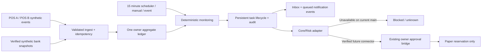

# MOT v1 architecture and acceptance boundary

## Source of truth and deployment

SoT is `realchenchenluo/agent` main. The local Node server (`chenchen/server.js`) and Cloudflare Worker are distinct HTTP processes. The repository's production `wrangler.toml` still points to `cloudflare/worker.js`, while MOT is wired to the newer `chenchen/deployment/worker.js`. The separate `wrangler.mot-staging.toml` uses a MOT-only public entry and its own `ReviewService` Durable Object. Its backend bundle passes Wrangler dry-run. The public chat is a separate deployment; it is not implicitly the same service or SHA. This candidate does not connect the public chat, change its domain, or assume its authentication.

`merchant/ledger.js` is a single-shop session demo and remains untouched. `core/memory.js` is in-memory consented session memory, not a bank ledger. `integrations/funding-plan.js` manages a separate synthetic investment plan and must not become an extra merchant balance source. `integrations/review-workflow.js` provides the Core/Risk/approval handoff for its existing contract; no trusted merchant plan contract is merged on current main. MOT exposes an adapter seam and reports `UNAVAILABLE` rather than creating a second live approval authority. The team `qiqi/` Python account and risk conversation are independent and are not copied into this SoT.

## Data and concurrency

One owner aggregate (`mot.v1`) contains stores, terminals, verified bank snapshots, raw business transactions, reservations, tasks, Inbox, notification events, memory, check runs, and append-only audit events. Transaction identity is `(source_system, external_transaction_id)`; exact replay is ignored, conflicting replays fail. Money is integer minor units in CNY. Total assets are computed only from verified account snapshots, never from summing POS transactions. Internal transfer legs are evidence and do not add to total assets. Pending receipts are reported separately from available funds. Available pool money is the sum of one or three selected verified accounts minus active paper reservations, only when all selected snapshots are fresh. Freshness allows at most five minutes of source clock skew; a later future timestamp stays unknown.

Node uses an atomic JSON file per owner in `MOT_DATA_DIR` and a per-owner in-process transaction queue. Deploy Node as a single writer for that directory. The Cloudflare path stores the same aggregate in `REVIEW_SERVICE` Durable Object storage under `mot:owner:<owner_id>`; the existing DO queue serializes updates, and each full aggregate is one storage write. No D1 or second ledger is created. On storage failure the API returns 503 with no success receipt. After an unknown response, the client reads the task and retries with the same idempotency key; it does not assume the action failed. File and DO formats share the same `mot-state.v1` contract.

The state machine supports `CREATED → CHECKING → NEEDS_ATTENTION → PENDING_APPROVAL → RESOLVED`, with `BLOCKED`, `FAILED`, `CANCELLED`, and `UNKNOWN`. Findings create one open task and one Inbox/notification event until resolved. New receipts and payments appear in check evidence. A missing/mismatched settlement, suspicious same-minute receipt, known seven-day funding shortfall, or stale pool balance produces a task. The scheduler checks each persisted owner every 15 minutes; the bucket key makes a replay return the same check. Events are queued for a future authorized notification service, but MOT sends no external messages.

## Authentication and authorization

Public Worker MOT routes require `MOT_AUTH_TOKENS_JSON`: an array of `{owner_id, token, roles}` with tokens at least 24 characters. Roles are `read`, `ingestor`, `operator`, and `approver`. Owner identity comes only from the authenticated token, never a request body or URL. The cron path requires a separate `MOT_CRON_SECRET`. `MOT_LOCAL_DEMO=true` enables a fixed local demo owner only on the Node loopback server when `PUBLIC_ACCESS` is disabled; production has no default demo identity. Cross-origin Node requests are rejected unless same origin. Core/Risk unavailability blocks approval and simulation. Browser callers cannot supply Risk approval evidence.

## REST contract

All routes are `/api/mot/*`, return JSON, and derive `owner_id` from server authentication. `GET` endpoints: `health`, `overview`, `stores`, `accounts`, `transactions`, `alerts`, `tasks`, `tasks/:id`, `inbox`, `runs`, `audit`, `memory`, `notification-events`. `POST` endpoints: `events/ingest` (`snapshot`, `idempotency_key`; automatically starts an event check), `check` (`idempotency_key`), `pool/configure` (`account_ids` length 1 or 3, `expected_revision`, `request_key`), `reservations/propose` (`amount_minor`, `account_ids`, `request_key`), `tasks/:id/approval` (`decision`, replayed per task), `tasks/:id/simulate` (`idempotency_key`), `memory` (`type`, `key`, `value`, `consent=true`, `request_key`). Node loopback demo additionally exposes `demo/ingest`. The Worker intentionally does not. Mutating calls fail closed on stale revision, missing data, invalid owner, permission, or storage failure.

## Migration and rollback

Initial schema version is `mot.v1` (`../contracts/mot-state.v1.schema.json`). No existing merchant or Core data is migrated. On unknown schema version, reads fail instead of guessing. Future migrations must transform one owner aggregate atomically and retain a backup. Rollback of code leaves `mot:owner:*` DO keys and Node owner JSON files intact; older code ignores them. Do not delete persisted state during rollback. Before deploying a later schema, test forward migration and rollback against a copied synthetic owner aggregate.

## UI compatibility and staging

UI PR #7 is still a Draft against main and changes `investment`/`risk-workbench` plus the static route whitelist. MOT uses a `/mot` module within the same local product host, reuses existing styling, and does not overwrite PR #7 assets. The `server.js` route addition will need a small whitelist merge when #7 is merged. The UI reads MOT API responses; it must show `UNAVAILABLE`, `UNKNOWN`, and missing data as such. Backend Staging uses `wrangler.mot-staging.toml` and requires Cloudflare deployment access plus `MOT_AUTH_TOKENS_JSON` and `MOT_CRON_SECRET` secrets. The MOT-only public entry rejects unrelated review routes. An authenticated same-origin frontend route is still required before a remote Staging UI can display owner data; do not place MOT tokens in browser JavaScript. No production Secret or public domain is changed by this branch.
