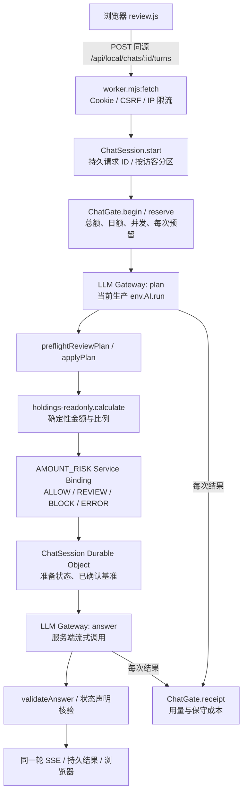

# Personal AI Fund Manager：模型额度诊断与网关候选版

检查时间：2026-10-24（北京时间）。状态词仅用“已验证通过 / 失败待修复 / 尚未验证”。本次只做本地代码、模拟上游与 Wrangler dry-run；没有购买服务、注入 Secret、推送 GitHub 或部署生产。

## A. 根因与可见证据

| 结论 | 状态 | 依据 |
| --- | --- | --- |
| 页面上的“今日模型额度已用尽”由**项目内部费用闸门**生成 | 已验证通过 | `gate.mjs` 的 `paidAllowed()`：北京时间日账本余额加单次 10 分预留若超过 `DAILY_BUDGET_CENTS`，返回 `DAILY_BUDGET_EXHAUSTED` / 429。`worker.mjs` 将该错误显示给访客。`wrangler.jsonc` 设每日 50 分、演示期总额 100 分。 |
| 触发时没有发起这次上游模型调用 | 已验证通过（2026-10-24 14:23 的保存快照） | 管理员 `/api/admin/status` 的本地保存快照显示 `today_used_cents=40.0203`、`per_call_reserved_cents=10`、`daily_cap_cents=50`、`accepting_calls=false`、43 次预留及 43 份回执。40.0203 + 10 > 50。此前独立合成访客发消息收到 429，见 `docs/access-evidence/full-probe-v6.2.json`。此快照不是现在的实时账单。 |
| Cloudflare 账户免费 Neurons、计费或平台限额也已耗尽 | 尚未验证 | 终端本轮读取线上 `/api/admin/status` 因 DNS `ENOTFOUND` 失败；Wrangler 配置 `observability.enabled=false`，本地没有可核验的平台账单/错误指标。Cloudflare 10,000 Neurons 免费日额度按 00:00 UTC 重置，与项目费用闸门的北京时间日界不同；不能混同。[官方定价与免费额度](https://developers.cloudflare.com/workers-ai/platform/pricing/)、[平台错误码](https://developers.cloudflare.com/workers-ai/platform/errors/)。 |
| DeepSeek / OpenAI / 其他服务商余额、速率和真实费用 | 尚未验证 | 未提供已确认的服务商账户、模型 ID、Secret、账单或从 Worker 出口的真实短请求记录。聊天中曾出现疑似凭据，未使用、未写入项目；持有者应先轮换。 |

管理员需手工核对：Cloudflare Workers AI dashboard 的 2026-10-24 UTC 日 Neurons、失败错误码 3036/3040、请求量、计费方案和账单；Worker 对应时间段的请求错误及版本；`/api/admin/status` 的当下只读 JSON（不要转发 ADMIN_TOKEN）；未来 A/B 服务商控制台的余额、赠送额度有效期、速率/并发上限和账单。实际扣费必须以供应商账单为准。

## B. 实际调用链与部署版本

这里没有 `/api/chat` 路由；等效接口是 `/api/local/chats/:id/turns`，流为 `/api/local/chats/:id/turns/:turnId/events`。入口在 `worker.mjs` 的 `fetch()`，访客 Cookie 与同源 CSRF 在 `session.mjs` / Worker 检查，持仓与对话只由访客对应的 `ChatSession` Durable Object 存取。`ChatSession.run()` 的 Planner 和 Answer 均走 `createModelGateway()`；生产配置没有 `LLM_GATEWAY_MODE=external`，所以仍走 `createCloudModel()` 和 `env.AI.run()`。现用模型 ID 为 `@cf/meta/llama-3.3-70b-instruct-fp8-fast`，单次输出上限 1024 tokens；官方模型页列出 24,000 tokens 上下文窗口。模型权重的更细版本号及本账户实际账单不可见。[Cloudflare 模型页](https://developers.cloudflare.com/workers-ai/models/llama-3.3-70b-instruct-fp8-fast/)。

最后一次取得的生产版本记录为 `chat-mobile-stability-20261024-v6.2`，Cloudflare version `c2043bfe-4fc9-48ff-8c97-ff4930f39145`，对应部署源码提交 `829df7d6f2b4c152ed54a39334db985ba555f78d`；本轮因 DNS 失败无法重新核对实时线上版本，故不把它称为现在实时确认的版本。本次开始时独立本地分支基线 `e15efc9e9df06a580e82228a0703b8844226398b`。`origin` 配置为 `realchenchenluo/agent`；GitHub 插件能读到 `main` 和 README，但 `main` 上的 `chenchen/integration/public-chat/wrangler.jsonc` 为 404，说明此线上候选源码尚未同步到该主分支。此前向该远程推送被自动审批拒绝，故本轮仍只保留本地分支。

## C. 最小改造与职责边界

本地候选版增加 `gateway-policy.mjs`、`llm-gateway.mjs`，并将现有 Cloudflare 路径作为统一入口的默认分支。`provider-adapter.mjs` 提供 OpenAI Chat Completions 协议传输，可配置官方 OpenAI、DeepSeek、xAI HTTPS 入口；每模型独立配置连接/响应超时、最大输出、最大消息长度、一次或两次尝试、日调用数与日费用上限。总计最多两次上游尝试：一次安全重试或一次主备切换。鉴权失败、协议/工具调用不兼容与部分流式输出不切换；备用调用不重放 Planner 后的工具、Memory、Risk 或持久写入。未知账单保留完整预留。

外部模式必须同时具备人工批准标志、模型与协议能力验证、计费边界验证、正数价格、保守汇率、逐模型日上限、Secret 和总预算内最坏情况费用；任何缺口在调用前拒绝。当前 `wrangler.jsonc` **没有**外部模式和外部 Secret，生产行为未变化。现有 App 由服务器编排工具：模型仅生成受校验的 Planner JSON 和解释文字；若供应商意外返回原生 `tool_calls`，适配层拒绝，绝不静默丢弃。`holdings-readonly.calculate` 负责金额/比例，Risk BLOCK/ERROR 在模型解释前终止，已确认记录须 Durable Object 写入成功才显示成功。规则仍是“Code calculates. Rules constrain. LLM interprets. Human approves.”

`ChatGate` 保留现有 10 分每逻辑模型调用预留、50 分日额和 100 分演示总额；新增逐模型保守预留与回执结算。`/api/admin/status` 新增当日**本版本启用后**的逻辑预留数、回执数、失败数、上游尝试数、已报告 input/output tokens、保守费用估算及逐模型额度。旧账本不会被重置，也不会把最近 20 条回执冒充全天完整统计。会话 Trace 已有 `request_id`、对话 ID、阶段、工具/记忆/风控结果；外部尝试只补充供应商、模型、HTTP 状态、耗时和安全错误码。显式质量捕获也只保存哈希与参数，不再保存原始提示词。浏览器资源不包含密钥。

## D. 成本公式与边界

Cloudflare 官方当前列出该模型每百万输入 $0.293、输出 $2.253。估算美元费用为 `input_tokens × 0.293 / 1,000,000 + output_tokens × 2.253 / 1,000,000`；项目旧账本用保守 `10 CNY/USD` 转换，并向上取整到微元。例如 1,000 输入 + 300 输出约 $0.0009689，即按该保守汇率约 ¥0.009689（约 0.969 分）。Planner 与 Answer 是两次模型调用；真正用量各自计入。失败/缺失 usage 时每次保留 10 分预留，不能据此宣称供应商已扣 10 分。[官方价格](https://developers.cloudflare.com/workers-ai/models/llama-3.3-70b-instruct-fp8-fast/)。

外部服务公式是 `Σ((输入 tokens × 未缓存输入峰值单价 + 输出 tokens × 输出峰值单价) / 1,000,000 × 保守 CNY/USD)`。备用或重试分别计成本，最坏两次必须在原 10 分逻辑调用预留内，否则配置拒绝。DeepSeek 有峰谷与缓存价，OpenAI 价格依具体模型；**未确定模型及购买账户，故不能填写实际或每月费用**。[DeepSeek 价格](https://api-docs.deepseek.com/quick_start/pricing/)、[OpenAI API 价格](https://developers.openai.com/api/docs/pricing/)。若供应商另计隐式推理、工具或其他费用，必须在验证计费边界前保持外部模式关闭。

## E. 本地验证与限制

构建 `node chenchen/integration/public-chat/build.mjs` **已验证通过**；与本改动直接相关的 9 个 Node 测试文件共 **79/79 通过**。先前候选版本的 Wrangler `deploy --dry-run` 通过；最终修订时因本机无法解析 npm registry 而未能重跑 Wrangler，最终打包结果仍**尚未验证**。模拟用例覆盖正常回答、内部预算 429、供应商 402/429、鉴权失败、连接超时、503、一次安全重试、备用模型读取 70,000 元和 42.86% 的确定性结果、流式终止标记、部分流禁止拼接、工具调用格式拒绝、逐模型日上限，以及费用回执/Token 汇总。既有测试覆盖 Risk BLOCK、访客隔离、持仓纠错与重复请求幂等。`public/` 三个构建资源扫描未见 Secret 名称或测试密钥。

整个 `chenchen` 测试集本轮未全部通过：旧本地集成用例缺少 `ajv/dist/2020` 依赖，且若干 HTTP 用例因沙箱禁止 `127.0.0.1` 监听而报 `EPERM`。包含 Memory/金融工具的扩展定向运行结果为 82 个测试中 80 通过、2 个因前述依赖失败。以上是**尚未验证**的环境缺口，不能计作产品回归通过。

这些测试全部使用替身，不是 DeepSeek/OpenAI 真实调用。由于未取得模型 ID、Secret 和服务商账户授权，真实兼容、服务端出口网络、中文质量、余额、额度、流式用量及实际账单均**尚未验证**。当前生产因预算闸门拒绝新模型调用，不进行重复消耗额度的冒烟测试。

## F. 部署与回滚

本地候选版未部署。若后续明确批准生产变更，先核验 A/B 官方模型 ID、参数、工具/JSON/流式、价格、余额、从 Worker 出口的一次短请求，以及 Risk/Memory Golden Path；再注入 Secret、设置逐模型上限，在小范围灰度检查 `/api/admin/status` 和供应商账单，最后发布。`wrangler.jsonc` 仍指向 Cloudflare 默认模式，单独部署本候选代码也不会启用外部服务。Cloudflare 生产回滚目标为 version `c2043bfe-4fc9-48ff-8c97-ff4930f39145`；回滚不清空 Durable Objects，也不能追回已产生费用。外部调用有未完成回执时先保留预留并核对账单，不将未确认结果当作免费。

## G. 人工配置清单

1. 轮换聊天中暴露过的疑似密钥，确认 A/B 所属账户、官方 Base URL、模型 ID、可用余额/有效期、限流和账单权限。只有持有者通过 Cloudflare Secret 注入 `LLM_A_API_KEY` / `LLM_B_API_KEY`；不要在聊天、配置文件或命令行参数里粘贴值。
2. 按 `providers.env.example` 提供协议、JSON、流式、计费边界验证标志，官方未缓存峰值输入/输出价、保守汇率、每模型超时/尝试/消息与输出上限、每日次数和费用上限。外部模式仅在完成审批与实测后手工设置 `LLM_GATEWAY_MODE=external`、`LLM_PAID_PROVIDER_APPROVED=true`。
3. Cloudflare 管理员核对实时 `/api/admin/status`、Workers AI Neurons/错误、付费方案和账单，并为故障追踪决定是否启用脱敏 Observability；当前部署配置关闭平台日志，不得捏造线上调用明细。
