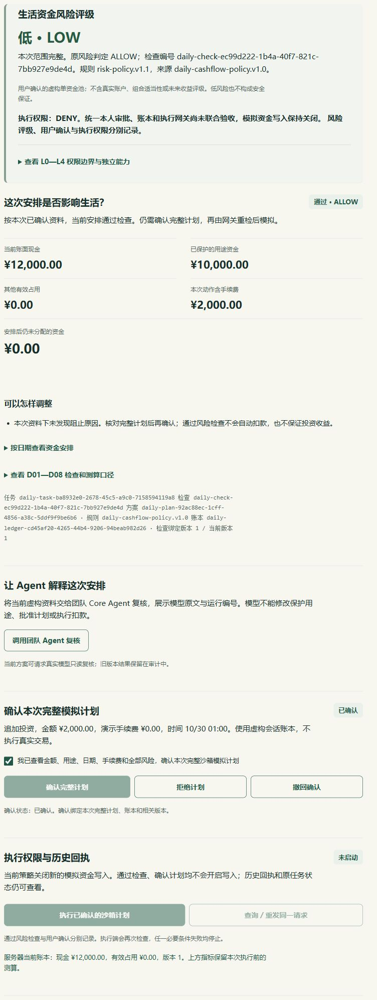

# 日常资金 v1.1：浏览器补验与确认重检修复

日期：2026-10-30，北京时间。负责人：Vesper。结论：**原低风险浏览器验证尾项已补验，过程中发现并修复确认重检评级缺失；修复后在原线上工作台第15版复查通过。**

## 1. 环境与虚构资料

- 原网址：`https://fund-risk-workbench.panxintian44.chatgpt.site/risk`，public范围不变。
- 本次从已发布第14版源码`797a930ad7233fa8e6015381105f47d515f08ecc`复核，补丁发布为第15版，Site源码`bde20b6dca5f3a4aa5b7bc815f73b0aac81cc8b7`。来源与部署ID见[部署记录](evidence/browser-20261030/deployment-v15.json)。
- 账面现金12000元；学费预留/待付6000元、房租1500元、生活费2500元，保护总额10000元；已有占用0元；已到账收入已经包含在余额，不重复增加；无额外硬保底，费用0元。
- 余额时间`2026-10-30 00:00`，拟动作时间`2026-10-30 01:00`；付款日分别为11月2日、10月31日、11月6日。
- 只读规则检查及**演示会话确认**。没有点击真实模型、执行或重复执行按钮；未连接本人身份认证，不把演示确认称为本人认证成功。未查询供应商账单或其他访客调用量。

## 2. 补验发现的问题

初次检查可行的2000元方案时，第14版正确显示LOW/ALLOW、剩余可分配0元。点击演示完整计划确认后，底座会重新检查并换一个`risk_check_id`，但统一评级只在创建/修改任务时记录，因此GET新检查找不到评级旁路，界面显示未知。执行一直关闭、余额未动；这是确认后评级追踪/显示缺失，不能把原第14版记录为该项全部通过。

证据：[v14确认后截图](evidence/browser-20261030/v14-confirmed-grade-missing.jpg)。新HTTP回归在原v14明确复现`unified_assessment=null`断言失败。

## 3. 修复与回归

`install-site.mjs`现在只接受完整匹配的已审查v13或v14基线。确认路由保留原确认调用和响应结构，随后对其新检查追加`UNIFIED_ASSESSMENT_RECORDED`，标明`assessment_stage=CONFIRMATION_RECHECK`，与新检查编号绑定。

不回写原评级，不修改原签名事件，不补造旧任务当年未保存的评级，不新增公开接口、不扩展冻结回调，也不打开执行入口。

- 评级/权限/资金/UI回归：**112/112**。本轮未改变这些业务计算规则；原487项程序测试的其余组仍保留原报告，不冒称又全部重跑。
- Worker HTTP：**30/30**，包括新增4项确认重检回归：新LOW/VALID与新check绑定；原review与审计保留；再次GET不追加历史；旧v1.0 LOW经新确认产生v1.1新旁路而旧审计不变。
- 从已审查v13副本复建并运行同一HTTP测试：**30/30**，验证旧基线复现能力。两次HTTP是相同30项在两个构建基线运行，不记成60个不同用例。
- HTTP替身外部请求、真实模型调用和模型额度写入均0。演示确认与真实本人授权、内存SQLite与团队托管账本仍分别标记。

证据：[v14基线修复后HTTP](evidence/browser-20261030/worker-http-30.json)、[v13基线复建HTTP](evidence/browser-20261030/worker-http-v13-baseline-30.json)、[构建来源](evidence/browser-20261030/site-build-v15.json)。

## 4. 第15版线上实测

| 步骤 | 实际观察 |
| --- | --- |
| 2000元恰好够用 | LOW/ALLOW、完整覆盖；12000－10000－2000=0，执行权限DENY |
| 演示确认前 | 完整计划未确认，执行关闭；必须逐项核对后才能提交演示确认 |
| 改为2000.01元 | 前端先标旧结果，相关按钮关闭；提交修改后HIGH/BLOCK、缺口0.01元，原确认已失效 |
| 改回2000元并重检 | LOW/ALLOW，使用新的方案与检查编号 |
| 再次演示确认 | 显示已确认；**评级保持LOW**，当前检查与评级引用一致，审计同时新增本次确认和新评级 |
| 执行与余额 | 执行、重复执行按钮始终关闭；执行状态未启动，账面现金12000元、占用0元、账本版本1 |

全程同一任务`daily-task-ba8932e0-2678-45c5-a9c0-7158594119a8`。一分钱超限检查为`daily-check-ad99d178-ab00-4414-9142-deb811c796bf`；修复后的最终确认检查为`daily-check-ec99d222-1b4a-40f7-821c-7bb927e9de4d`。这些是虚构会话追踪标识，不是跨用户读取授权。

机器记录：[观察汇总](evidence/browser-20261030/summary.json)、[最终LOW页面文字](evidence/browser-20261030/v15-low-confirmed.json)、[一分钱BLOCK页面文字](evidence/browser-20261030/v15-one-fen-block.json)。

完整页面另见[最终LOW截图](evidence/browser-20261030/v15-low-confirmed.jpg)和[一分钱超限截图](evidence/browser-20261030/v15-one-fen-block.jpg)。

## 5. 验收范围与交接

本次补验闭合了v1.1低风险页面、演示确认后评级及变参失效的验证尾项；**不构成团队问答入口、正式本人审批、共享账本或资金执行联合验收**。原v14证据保留，当前发布版本为v15。

下一步按[队友交接请求](队友交接请求-2026-10-30.md)先把只读评估接入团队现有问答入口。请求仅整理为待发送文本，没有代发群消息、创建团队Issue或授予权限。
