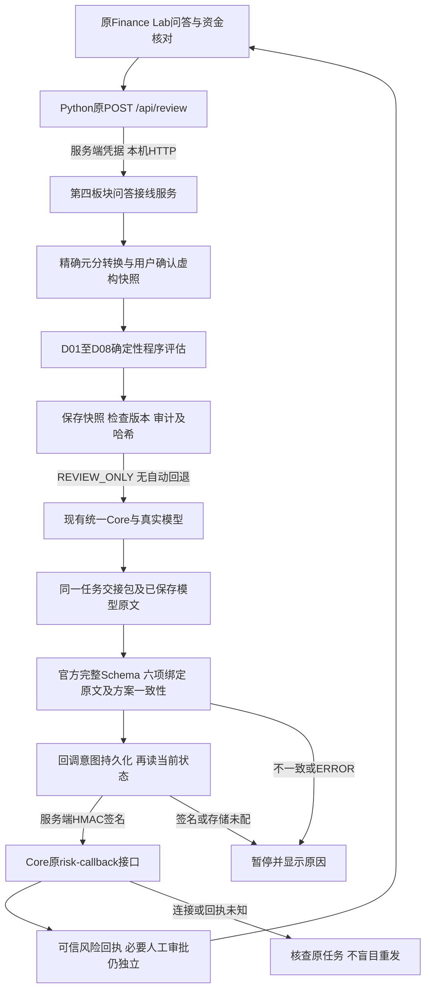

# 对话风控与正式回调接入 v1.0

记录日期：2026-10-21。状态：**代码及本地兼容测试通过，跨模块待评审；线上可信签名联调未完成**。

## 1. 最新会议与Vesper分工

用户明确：**潘心恬 Vesper 是第四板块负责人**。本次纪要未提供会议日期，不推定其时间。

| 负责人 | 本轮对应职责 | 边界 |
| --- | --- | --- |
| Vesper／第四板块 | 排查GitHub读取；将资金风险标准、警告和调整方向接入原问答；校验正式风险回调 | 不代替其他Owner重构整个UI或修改模型训练方案 |
| 金怡含／七七 | 语义理解、模型服务、原问答后端与按钮接线 | 本轮对其原`/api/review`作可选代理，保留既有接口 |
| 林粹／Core Owner | 共享后端、Cloudflare权限协助、可信身份及签名配置 | 正式上线前与第四板块确认双方共享配置 |
| 石之海／UI | 对话框为主、侧栏技能和记忆、首页滚动进入 | 本轮只新增原问答资金核对区，不另建网站或替换新UI设计 |

“Codex只支持GitHub部署”“当前不能调用模型API”作为会议反馈保留，不能直接当作已核实事实。本轮Git拉取正常；公开Core能力接口显示模型已配置，但未作推理探测。美元展示及会上提及的论文框架仍待团队确定，本轮不自行扩展。

## 2. 用户看到什么

原问答接口仍为 **POST `/api/review`**。原页面理财问答区新增可展开的“核对本次资金安排（虚构）”。用户输入现金、准备投入、费用、其他占用、备用现金和房租／学费保护用途，分别确认事实与约束。

示例：现金10000元、明确其他占用及费用均为0、房租保护4000元、拟投资8000元。程序给出当前可新增安排6000元、缺口2000元和降低／延后投入的建议；不会自动减少房租保护。用户未填的金额仍未知，包括费用及占用，不默认0。

页面分别展示：程序金额与原因、下一步方向、真实模型原文、正式回调状态、必要审批状态和任务／审计关联。模型和审计详情默认折叠，不把专业日志直接作为主回答。旧股票买卖按钮不出现在此只读分支。

本轮只支持一个用户自述并确认的虚构资金池。尚未接真实账户、可信长期Memory、跨任务银行占用，也没有把一句话抽取结果直接升级为已确认事实。整段文字里的工资、房贷和学费需进一步由用户核对，不能由模型补造结构化金额。

## 3. 原入口与架构



所有资金安排请求固定为 `PAPER + REVIEW_ONLY`。风险ALLOW可被记录为APPROVE，但本入口不提供审批／模拟执行操作，也不会把“等待审批”写成“交易完成”。

原Python服务未配置新接线且未提交资金表时，原理财流程保持兼容；提交资金表却未配置服务时明确503，不能悄悄走旧模型。新接线启用后，原`/api/review`使用同一服务，不再建立第二个问答入口。

最新精简`workspace`预览分支`14c92ba`的主对话目前仍只是草稿；七七`05fc435`增加的`/api/core-agent/review`未自动改动原按钮。本轮接的是原Python问答入口，不冒称上述静态预览或当前公开Site已同步部署。最新UI迁移时复用本响应契约，由Owner接入。

## 4. 新增输入与输出

浏览器／Python提交：

```json
{
  "question": "想投入8000元，但下个月要交房租，会影响生活吗？",
  "idempotency_key": "conversation-example-001",
  "daily_finance_yuan": {
    "cash_yuan": "10000.00", "amount_yuan": "8000.00",
    "fees_yuan": "0", "holds_yuan": "0", "floor_yuan": "0",
    "purpose_yuan": "4000", "due_yuan": "4000",
    "due_date": "2026-11-01", "purpose_label": "房租",
    "facts_confirmed": true, "purpose_confirmed": true
  }
}
```

这是原问答接口的**可选内部封装提案**，不改变Core的`model-review.v1`与`risk-callback.v1`。`daily_finance_yuan`不接受身份、Risk结果、已审批或执行权限字段。金额使用原文字符串／null；问题最多20000字符，超出明确拒绝，不截去末尾约束。

服务端通过已有金额适配归一为`conversation-finance.v1`：沿用日常`daily-risk-workbench.v1`的snapshot/action字段，明确`SYNTHETIC_REPLAY`及`existing_holds_minor`。新封装待共享契约负责人评审，不冒充旧版本已支持新增字段。

响应保留原任务／运行／方案／审计标识和模型原文，新增：

| 字段 | 含义 |
| --- | --- |
| `risk_advice` | 程序四态、指标、保护用途、原因、警告、调整方向、确认状态，`program_generated=true` |
| `assistant_message` | 程序结论与实际数字；不由模型改写 |
| `model_raw`、`model` | Core实际原文和模型证据；仅提供解释，与规则结果分开 |
| `risk_callback.status` | RECORDED、DUPLICATE、NOT_SENT或UNKNOWN；后两种不能显示已接通 |
| `risk_check_id/policy_version/proposal_sha256` | 风险检查、版本与完整提议关联 |
| `execution_state` | awaiting_risk、awaiting_approval、blocked、not_executed；不伪装成功交易 |
| `execution_allowed/executed/queued` | 本只读入口均为false；不进入旧执行队列 |

模型服务失败返回非2xx和错误，保留已完成的程序诊断时明确其来源；没有备用模型文本替身。真实模型已返回但后续交接失败时，可保留已核对的实际原文，并如实标记交接失败。

## 5. 正式回调及失败处理

1. 从当前Core读取官方完整Handoff，使用Ajv及官方所有关联Schema验证；再核对关键状态、六项绑定与完整proposal摘要。
2. 首次模型响应、保存的任务、Handoff、回调后的任务必须对应同一完整提议和模型证据；供应商回执允许null，不能只凭其一个编号绑定原文。
3. 先保存规范化虚构快照和程序结果，记录其哈希；发送前复核快照哈希、检查编号、规则版本及当前状态。演示技术检查有效期15分钟，非金融行业标准。
4. 回调只含官方10字段。服务端使用现有Core `canonicalJson/signatureFor`生成`X-Risk-Signature`，携带机器访问凭据；前端不接触凭据。
5. 发送意图可靠落盘后，再次核对当前状态才发出。回执须保留相同决定、原因、身份、六项绑定及可信HMAC认证证据，不能接受`DEMO_UNVERIFIED`充当正式可信回执。
6. ERROR不发业务回调；REVIEW／BLOCK／ALLOW分别映射REQUEST_MORE_INFO／REJECT／APPROVE。原始复核原因不覆盖；复核补充后新建任务重新检查。
7. 超时、断线、签名失败、无有效回执、结果审计失败均进入UNKNOWN或失败暂停。不得盲目重发；相同问答内容重试复用同一幂等编号，已保存成功结果只重放。
8. 默认模型请求上限20次／UTC日，可配置1—100；是演示费用控制，不是理财规则。调用失败也计次，避免重试耗费。

## 6. 服务端配置与启动

不把密钥提交GitHub、放入浏览器或发送到聊天。配置由部署环境或服务端密钥管理提供。

| 环境变量 | 用途／负责人 |
| --- | --- |
| `CORE_AGENT_BASE_URL` | 正式Core源站，默认团队已给出的Worker域名；不能使用仅开放review的千问分享站回调 |
| `CORE_AGENT_API_KEY` | Core机器调用身份，Core Owner在双方服务端配置 |
| `RISK_SERVICE_HMAC_SECRET` | 与Core一致的Risk签名密钥；兼容`RISK_HMAC_SECRET`别名 |
| `RISK_REVIEWER_ID` | 服务端固定Risk身份标签，不从用户表单读取 |
| `RISK_CONVERSATION_API_KEY` | Python→本机Node服务身份，至少24个ASCII非空格字符；两个进程需一致 |
| `RISK_CONVERSATION_BASE_URL` | Python连接本机Node，如`http://127.0.0.1:8790` |
| `REQUIRE_TRUSTED_ACTORS=true` | Core侧启用严格Owner签名；由Core Owner配置 |
| `RISK_CONVERSATION_PORT` | Node本机端口，默认8790 |

本实现只监听127.0.0.1。若需独立公网部署，须由Owner提供正式认证、密钥管理和部署适配，不能直接把本机端口暴露成公共接口。本轮没有新建展示站点。

在环境变量配置完成后：

```powershell
# 仓库根目录；安装锁定的运行依赖
npm --prefix modules/safety-risk-eval/interface-adapters ci --ignore-scripts
# 终端一：本机服务，沿用服务端配置，不打印凭据
node modules/safety-risk-eval/interface-adapters/conversation-server.cjs
# 终端二：使用已安装Finance Lab原依赖的Python启动原问答端
python qiqi/web/app.py
```

本机HTTP Core地址只在显式`RISK_ALLOW_LOCAL_HTTP=true`且回环域名时允许，用于测试；正式Core保持HTTPS。`.runtime`私有快照、审计、测试环境与node_modules均被忽略，不提交仓库。

## 7. 线上状态与剩余交接

2026-10-21只读GET团队Core `/api/review/capabilities`成功：模型显示已配置，但`inference_probe=NOT_RUN`；Risk的`callback_signature_configured=false`，派发地址及签名也未配置。当前本机必要服务凭据未注入。本轮没有付费模型调用或线上回调。

因此剩余步骤清楚区分：

- **Vesper已提供：** 程序标准、原入口接线、正式签名发送器、审计及本地可复跑测试。
- **林粹／部署Owner待配置：** 双方可信凭据、Core严格签名模式及部署服务；现有Core→Risk主动派发未启用，本轮采用服务端拉取Handoff。
- **七七／UI Owner待部署核对：** 在实际对话服务启用本代理，随后将同一响应接入已确定的新workspace；线上失败仍显示失败。
- **联合验收待执行：** 同一真实模型任务的BLOCK、REVIEW、ALLOW等待审批、签名失败及UNKNOWN路径；涉及模型费用时按团队预算执行，不用测试替身声称通过。
